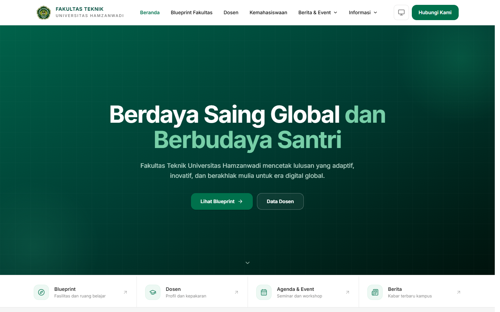
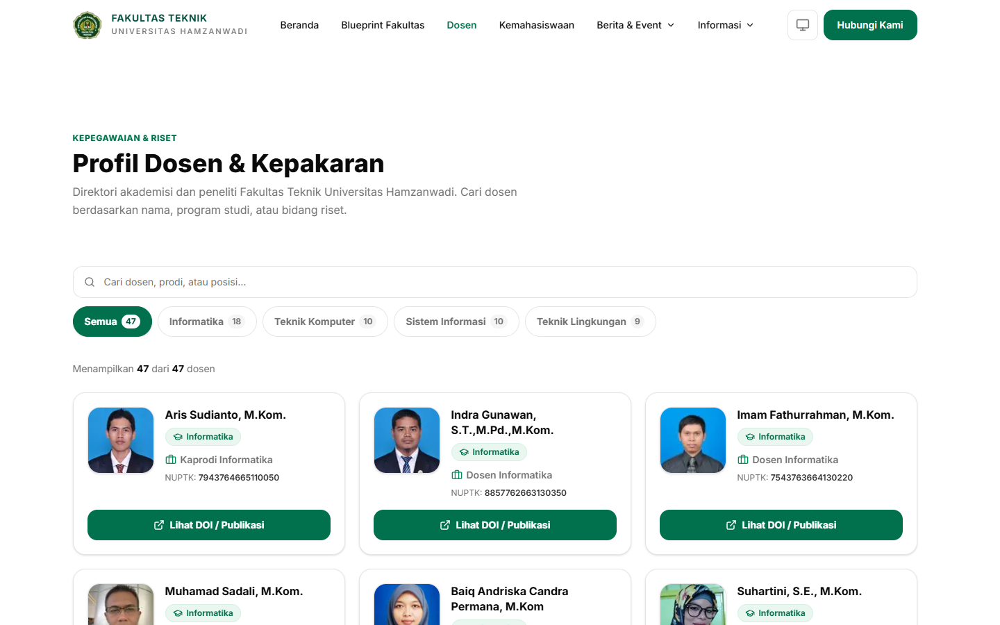
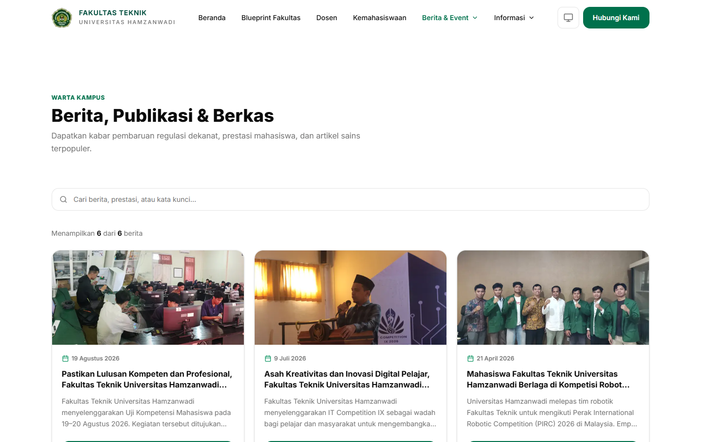
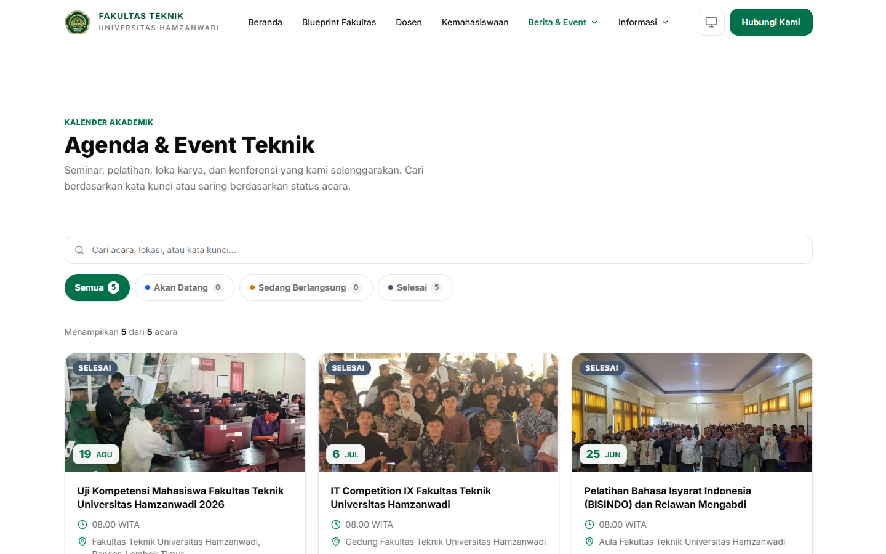
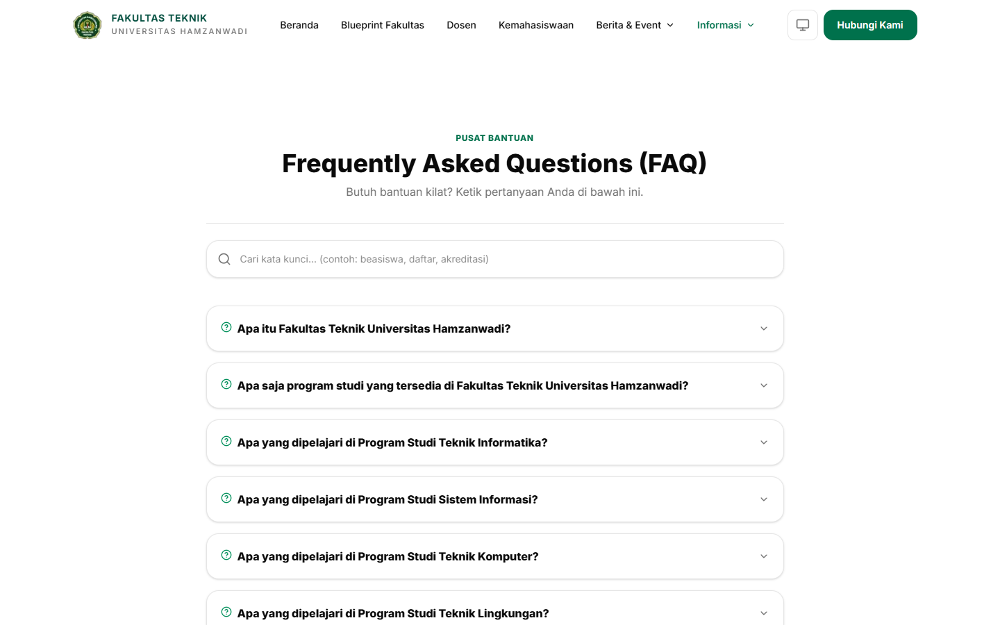
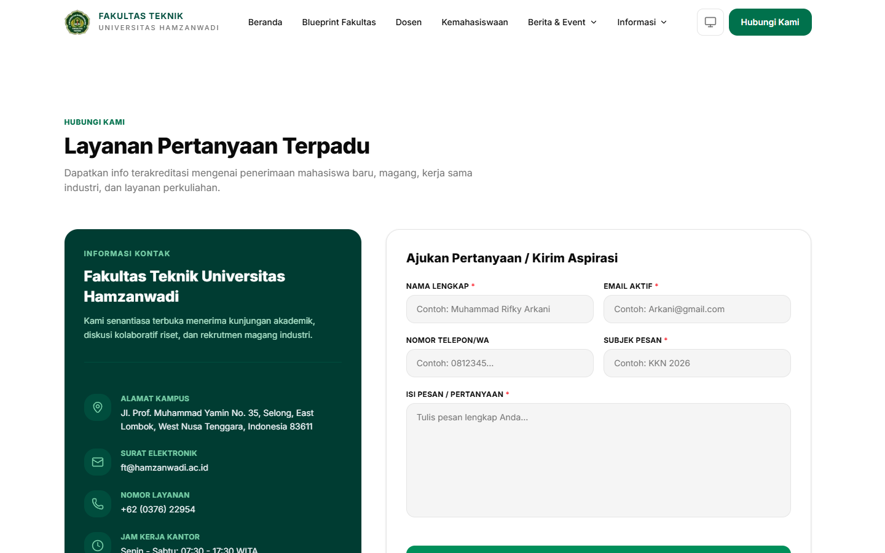
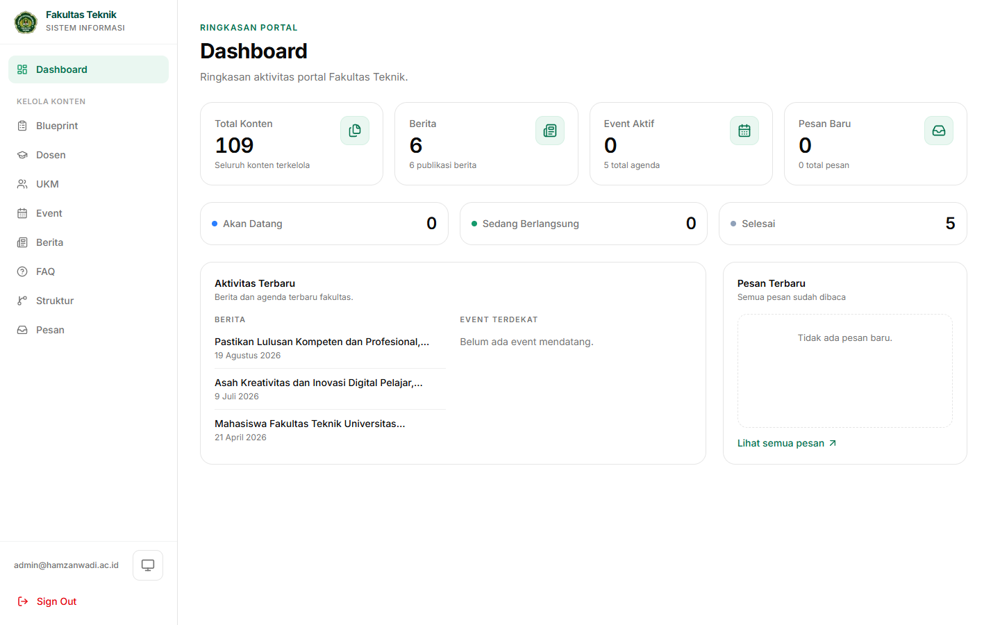
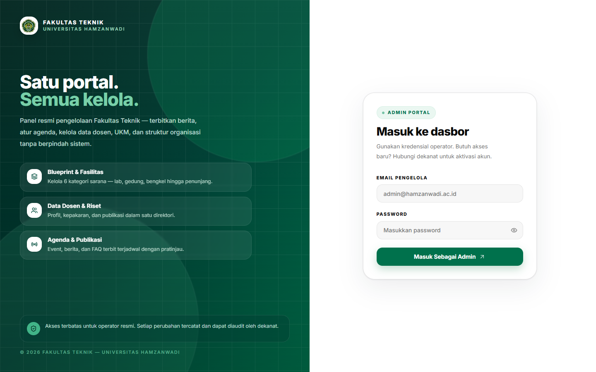

# Portal Fakultas Teknik Universitas Hamzanwadi



Portal informasi resmi Fakultas Teknik Universitas Hamzanwadi, dilengkapi panel admin untuk mengelola seluruh konten. Proyek ini dikembangkan sebagai implementasi skripsi, bukan sekadar hasil clone template. Halaman publik dan CMS dibangun di atas fondasi Next.js 16, Prisma 7, Better Auth, dan UploadThing.

Pengunjung dapat membaca profil fakultas, menelusuri fasilitas dan laboratorium, mencari dosen, melihat agenda dan berita, membaca struktur organisasi, mencari FAQ, serta mengirim pesan. Administrator mengelola semua konten itu dari satu dashboard tanpa menyentuh kode.

## Konteks Akademik

Repo ini merupakan bagian dari penelitian skripsi untuk merancang dan membangun portal fakultas berbasis web. Fokus penelitiannya ada pada penerapan Next.js App Router, pemisahan data server dan client, cache berbasis tag, serta CMS satu admin yang cukup sederhana untuk dioperasikan staf fakultas.

Spesifikasi, rencana implementasi, model data, dan daftar tugas tersedia di [`specs/001-faculty-website/`](specs/001-faculty-website/).

## Tujuan

- Memusatkan informasi fakultas yang sebelumnya tersebar di banyak kanal ke satu portal resmi.
- Memberi administrator kendali penuh atas konten tanpa perlu bantuan pengembang untuk setiap perubahan.
- Menjaga konsistensi data antara halaman publik dan dashboard melalui satu sumber data, yaitu PostgreSQL.
- Menerapkan praktik pengembangan web modern sebagai studi kasus skripsi: type safety, server components, caching, autentikasi, dan keamanan dasar.

## Fitur Utama

### Portal publik

- Beranda dengan ringkasan profil, statistik fakultas, fasilitas, dosen, agenda, berita, kehidupan mahasiswa, dan FAQ.
- Blueprint Fakultas berisi daftar gedung, laboratorium, dan sarana penunjang dengan tata letak bergantian.
- Direktori Dosen dengan pencarian dan filter program studi. Setiap kartu menampilkan jabatan, NUPTK, dan tautan publikasi atau DOI.
- Halaman UKM berisi profil organisasi mahasiswa, kegiatan, dan kontak.
- Agenda dan Event dengan pencarian, filter status (Akan Datang, Sedang Berlangsung, Selesai), dan halaman detail berbasis slug.
- Berita dan Publikasi dengan pencarian, kartu artikel, serta halaman detail berisi konten lengkap dan tautan sumber.
- Struktur Organisasi dalam bentuk hierarki pimpinan fakultas yang responsif.
- FAQ dengan pencarian real-time dan accordion.
- Hubungi Kami dengan validasi form, honeypot, pembatasan satu pesan per IP per lima menit, dan peta Google Maps dengan fallback alamat statis.
- Tema terang dan gelap, navigasi sticky, tampilan responsif, serta dukungan PWA (install prompt dan halaman offline).

### Panel admin

- Login satu administrator melalui Better Auth dengan session cookie dan pembatasan email admin.
- Dashboard berisi statistik konten, status event, aktivitas terbaru, dan pesan masuk.
- CRUD untuk Blueprint, Dosen, UKM, Event, Berita, FAQ, dan Struktur Organisasi.
- Pengelolaan pesan: daftar, filter sudah atau belum dibaca, detail, tandai dibaca, dan hapus.
- Form generik yang dikonfigurasi per model, termasuk validasi field wajib, slug otomatis, urutan tampil dosen, dan unggah gambar.
- Invalidasi cache per tag setelah data berubah, sehingga halaman publik langsung menampilkan data terbaru.

### Fondasi teknis

- `"use cache"` dan `cacheTag` pada fungsi baca di `lib/faculty.ts`, lalu `updateTag` dan `refresh()` setelah mutasi.
- Pemisahan modul server dan client untuk menjaga Prisma serta `"use cache"` tetap di sisi server.
- Security header di `next.config.ts`: CSP, HSTS di produksi, `X-Frame-Options`, `X-Content-Type-Options`, dan `Referrer-Policy`.
- Proteksi route `/dashboard` dan `/upload` lewat `proxy.ts`, bukan `middleware.ts`.
- Konfigurasi terpusat di `lib/`, dengan daftar environment variable yang dibutuhkan di `.env.example`.
- SEO dasar: metadata, `sitemap.xml`, `robots.txt`, manifest PWA, dan `llms.txt`.

## Tangkapan Layar

| Beranda | Direktori Dosen |
| --- | --- |
|  |  |

| Berita dan Publikasi | Agenda dan Event |
| --- | --- |
|  |  |

| FAQ | Hubungi Kami |
| --- | --- |
|  |  |

| Dashboard Admin | Login Admin |
| --- | --- |
|  |  |

## Teknologi

| Teknologi | Versi | Peran dalam proyek |
| --- | --- | --- |
| Next.js | 16.2 | App Router, Server Components, `use cache`, route handlers |
| React | 19.2 | Antarmuka halaman publik dan dashboard |
| TypeScript | 5 | Type safety di seluruh kode |
| Prisma | 7.8 | ORM dan migrasi database |
| Neon PostgreSQL | - | Database serverless untuk data fakultas |
| Better Auth | 1.6 | Autentikasi email dan password untuk admin |
| UploadThing | 7.7 | Unggah gambar dan penyimpanan CDN |
| Tailwind CSS | 4 | Styling dan token desain |
| shadcn/ui, Radix UI | 4.13, 1.4 | Komponen antarmuka yang aksesibel |
| Framer Motion | 12 | Animasi dan transisi halaman |
| Bun | Terbaru | Package manager dan runtime skrip |

Font memakai Inter melalui `next/font/local` agar tidak bergantung pada request font eksternal. Arah desain dan token warna dicatat di [`DESIGN.md`](DESIGN.md).

## Struktur Proyek

```text
app/
├── (public)/              # Halaman publik tanpa login
│   ├── page.tsx           # Beranda
│   ├── blueprint/         # Fasilitas dan laboratorium
│   ├── dosen/             # Direktori dosen
│   ├── ukm/               # Unit kegiatan mahasiswa
│   ├── event/             # Agenda dan detail event
│   ├── berita/            # Berita dan detail berita
│   ├── struktur/          # Struktur organisasi
│   ├── faq/               # Tanya jawab
│   └── hubungi/           # Form kontak dan peta
├── (auth)/login/          # Login administrator
├── (dashboard)/           # Area admin yang dilindungi
│   ├── dashboard/         # Statistik dan CRUD per model
│   └── upload/            # Halaman demo unggah
├── api/                   # Endpoint Better Auth dan UploadThing
├── layout.tsx             # Layout root, tema, dan PWA
└── globals.css            # Tailwind dan token desain

components/
├── admin/                 # Komponen CMS
├── dashboard/             # Tabel, pagination, dialog, state
├── sections/              # Section halaman publik
├── shared/                # Header, footer, navigasi, tema
├── ui/                    # Primitif shadcn/ui
└── upload/                # Komponen unggah gambar dan file

lib/
├── auth.ts                # Konfigurasi Better Auth
├── prisma.ts              # Prisma client dengan Neon adapter
├── faculty.ts             # Query publik dengan cache tag
├── admin-actions.ts       # Server action CRUD admin
├── actions.ts             # Form kontak dan aksi berita
├── admin-field-configs.ts # Konfigurasi field per model
└── env.ts                 # Validasi environment variable

prisma/
├── schema.prisma          # Model database
└── seed.ts                # Data awal dan akun admin
```

Tidak ada direktori `src/`. Kode aplikasi berada di root repo agar sesuai dengan konvensi Next.js 16 yang dipakai proyek ini.

## Menjalankan Secara Lokal

### Prasyarat

- Bun sudah terpasang. Jika belum, lihat [bun.sh](https://bun.sh).
- Database Neon PostgreSQL. Proyek memakai `@prisma/adapter-neon`, jadi connection string harus berasal dari Neon.
- Akun UploadThing untuk token unggah gambar.
- Git.

### 1. Clone dan instal dependensi

```bash
git clone https://github.com/XArkani/Project_Skripsi.git
cd Project_Skripsi
bun install
```

### 2. Siapkan environment variable

Salin template yang tersedia:

```bash
cp .env.example .env
```

Di PowerShell:

```powershell
Copy-Item .env.example .env
```

Isi `.env` sesuai daftar berikut.

| Variabel | Keterangan |
| --- | --- |
| `DATABASE_URL` | Connection string Neon PostgreSQL |
| `ADMIN_EMAIL` | Email akun administrator tunggal |
| `ADMIN_PASSWORD` | Password akun administrator |
| `BETTER_AUTH_SECRET` | Kunci rahasia Better Auth, buat dengan `openssl rand -base64 32` |
| `BETTER_AUTH_URL` | URL aplikasi, misalnya `http://localhost:3000` |
| `NEXT_PUBLIC_APP_URL` | URL publik aplikasi, nilainya sama dengan `BETTER_AUTH_URL` di lokal |
| `UPLOADTHING_TOKEN` | Token dari dashboard UploadThing |

### 3. Siapkan database

```bash
bun run db:migrate
bun run db:seed
```

`db:migrate` menjalankan `prisma migrate dev` dan membuat tabel. `db:seed` membuat akun admin dari `ADMIN_EMAIL` dan `ADMIN_PASSWORD`, lalu mengisi data contoh fakultas.

Perhatian: seed mereset tabel `blueprint`, `ukm`, `faq`, dan `struktur`. Tabel `dosen`, `event`, dan `news` di-upsert agar tidak menghasilkan duplikat. Jangan jalankan seed di database produksi yang sudah berisi konten asli tanpa memeriksa `prisma/seed.ts` terlebih dahulu.

### 4. Jalankan server

```bash
bun run dev
```

Buka [http://localhost:3000](http://localhost:3000).

### 5. Masuk ke panel admin

- Buka [http://localhost:3000/login](http://localhost:3000/login).
- Masuk dengan `ADMIN_EMAIL` dan `ADMIN_PASSWORD` dari `.env`.
- Setelah login, Anda diarahkan ke `/dashboard`.

## Perintah yang Tersedia

| Perintah | Fungsi |
| --- | --- |
| `bun run dev` | Menjalankan server pengembangan |
| `bun run build` | Menjalankan `prisma generate` lalu build produksi |
| `bun run start` | Menjalankan hasil build produksi |
| `bun run lint` | Menjalankan ESLint |
| `bun run typecheck` | Memeriksa tipe dengan `tsc --noEmit` |
| `bun run db:generate` | Membuat Prisma Client |
| `bun run db:migrate` | Membuat dan menerapkan migrasi |
| `bun run db:seed` | Mengisi data awal dan akun admin |
| `bun run db:studio` | Membuka Prisma Studio |

## Catatan Pengembangan

Perubahan skema database harus selalu diikuti migrasi dan generate:

```bash
bunx prisma migrate dev --name nama-perubahan
bunx prisma generate
```

Menjalankan `prisma generate` tanpa migrasi tidak mengubah struktur tabel dan bisa menyebabkan error "column does not exist" saat runtime.

Modul yang memakai Prisma, `"use cache"`, atau `"use server"` hanya boleh diimpor dari Server Component. File dengan `"use client"` tidak boleh mengimpor `lib/faculty.ts`, `lib/prisma.ts`, atau `lib/actions.ts` secara langsung.

Setelah mengubah halaman yang mengambil data, jalankan `bun run build`. Pelanggaran batas Server dan Client Component serta akses data tanpa Suspense biasanya baru muncul saat build, bukan saat `typecheck` atau `lint`.

## Batasan

- Hanya ada satu administrator. Tidak ada registrasi publik, peran bertingkat, atau manajemen pengguna.
- Tidak ada sistem pembayaran, forum, komentar, notifikasi real-time, atau multi-bahasa. Antarmuka sepenuhnya berbahasa Indonesia.
- Belum ada automated test. Kualitas dijaga melalui `bun run lint`, `bun run typecheck`, dan `bun run build`.
- Data di `prisma/seed.ts` adalah contoh untuk pengembangan. Ganti dengan data resmi fakultas sebelum dipakai di produksi.
- Dukungan PWA terbatas pada manifest, service worker, dan halaman offline dasar.

## Kredit dan Lisensi

Proyek ini dimulai dari template [CodeNight Starters](https://github.com/oyanmuhammad/codenight-starter) karya Oyan Liberta, lalu dikembangkan menjadi portal fakultas dan CMS untuk kebutuhan skripsi. Atribusi lisensi asli tetap disimpan di [`LICENSE`](LICENSE).

Kode proyek mengikuti lisensi MIT yang sama dengan template tersebut.

## Kontak

Fakultas Teknik Universitas Hamzanwadi  
Jl. Prof. Muhammad Yamin No. 35, Selong, Lombok Timur, Nusa Tenggara Barat 83611  
Email: [ft@hamzanwadi.ac.id](mailto:ft@hamzanwadi.ac.id)  
Telepon: +62 (0376) 22954
